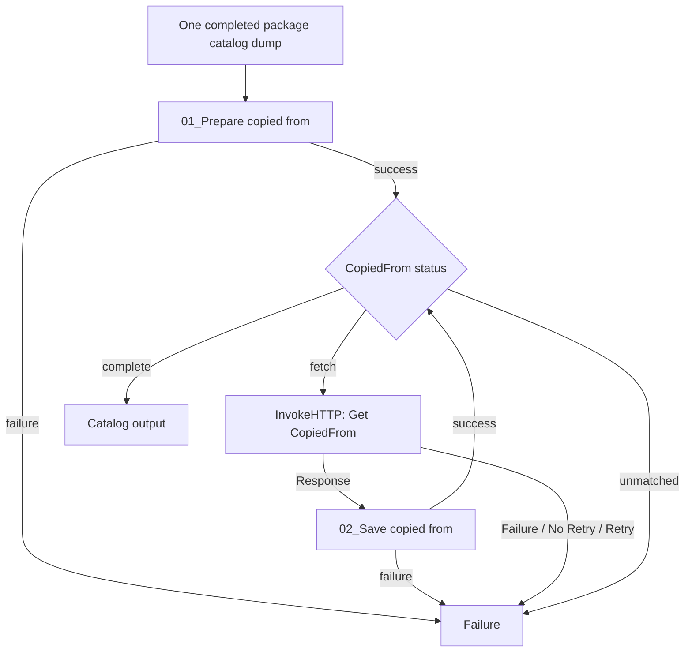

# Catalog: export CopiedFrom item parts

Add this group to **film → Produksjon → Catalog → Catalog**. It uses the existing
catalog InvokeHTTP connection and saves full source records beside the other
descriptive dumps as `<package.name>_COPIED_FROM_<priref>.xml`. For the test:

```text
digifilm_815655_20130726_COPIED_FROM_69119828.xml
digifilm_815655_20130726_COPIED_FROM_69119830.xml
```

Only produksjon files/configuration need deploying. The
[production-local submission extractors](../07_Submission%20body/README.md)
are included so this flow can be updated without new bevaring changes.

## Placement in the supplied Catalog PG

Keep the existing path and append the new group after the current join:

```text
Set urn
  → Get and putfile Digital item part
  → Split part of reference prirefs into flowfiles
  → Get and putfile Digital item/Manifest/Work
      (including its existing FragmentsToEmpty completion)
  → NEW: Get and save CopiedFrom item parts
  → Output - Cat dump
```

Feed **one package FlowFile after the existing parent requests have been joined**.
Do not branch from the original item-part response or insert this after each
parent fragment. Submission preparation and E-ARK wait for this group to finish.

The scripts read the package's staged `DIGITAL_ITEM_PART` dumps, select current
item parts by `media.urn` (otherwise the package URN), and collect only direct
`CopiedFrom/copied_from.lref` IDs. Repeated references are deduplicated. They do
not follow a parent ITEM or another generation of source history.

## Processors and connections

Create two ExecuteGroovyScript processors, one RouteOnAttribute and one InvokeHTTP.
The same router handles success from both scripts:



1. **Prepare CopiedFrom**: Script Body from
   [01_Prepare copied from.groovy](01_Prepare%20copied%20from.groovy).
2. **Route CopiedFrom status**: strategy **Route to Property name**; add:

   | Property | Value |
   |---|---|
   | `fetch` | `${catalog.copied_from.status:equals('FETCH')}` |
   | `complete` | `${catalog.copied_from.status:equals('COMPLETE')}` |

   `fetch` goes to InvokeHTTP, `complete` to Catalog output, and `unmatched`
   to Failure. Zero sources pass directly through `complete`.

3. **Get CopiedFrom**: copy the existing catalog InvokeHTTP's authentication,
   SSL/proxy settings and parameter context. Set:

   | Property | Value |
   |---|---|
   | HTTP Method | `GET` |
   | HTTP URL | `#{collection_url}search=priref%20%3D%20${catalog.copied_from.priref}&output=xml&database=catalogue` |
   | Response Body Attribute Name | No value |
   | Response Body Ignored | `false` |
   | Response Generation Required | `false` |
   | Response Cache Enabled | `false` |

   This is the supplied `search=priref = <id>` query with spaces/equality sign
   encoded. Keep the existing `collection_url` prefix. The dedicated request
   attribute leaves the existing generic `priref` unchanged.

   Connect **Response only** to Save CopiedFrom. Auto-terminate **Original**;
   do not send that request FlowFile onward as an additional package. Route
   **Failure**, **No Retry** and **Retry** through the existing error-message
   path to Catalog Failure. Failed packages can be rerun later.

   These properties and inherited request attributes on Response were checked
   against the [official NiFi 2.2.0 InvokeHTTP source](https://github.com/apache/nifi/blob/rel/nifi-2.2.0/nifi-extension-bundles/nifi-standard-bundle/nifi-standard-processors/src/main/java/org/apache/nifi/processors/standard/InvokeHTTP.java).

4. **Save CopiedFrom**: Script Body from
   [02_Save copied from.groovy](02_Save%20copied%20from.groovy). Connect `success`
   back to the same router, and `failure` to Catalog Failure.

Use one concurrent task per new processor and one active FlowFile per package.
Requests are sequential: one response advances the queue to the next source.
No new SplitText, MergeContent or FragmentsToEmpty is needed. Zero, one, two
or more distinct sources are supported.

## Validation, retries and state

Prepare resets its own `catalog.copied_from.*` attributes. Package identity,
paths, checksum results and existing catalog metadata remain intact. Current
item-part exports must exist in `metadata.descriptive.dir`; missing exports or
a missing package-URN match fail instead of using an old FlowFile `priref`.
A matched item part without copy links is a valid zero-source case.

Save requires HTTP 2xx and exactly one active `ITEM_PART` with the requested
priref. An empty record list, wrong record, parent ITEM, login HTML or malformed
XML fails without replacing an earlier valid dump. Missing optional title or
format is allowed. The original response XML bytes are written through a
temporary file and replace the same package/source filename. Replaying the
same request state rewrites that filename; rerunning Prepare refetches all
current source IDs. Neither media nor the finished SIP under `transfer` is changed.

The package continues only after all sources have been saved. The completed
body is empty, matching the existing catalog join; later extractors read files.

| Attribute | Meaning |
|---|---|
| `catalog.copied_from.ids` | JSON array of unique source IDs |
| `catalog.copied_from.count` | Number required |
| `catalog.copied_from.saved.count` | Number successfully saved |
| `catalog.copied_from.priref` | Current request ID; absent on completion |
| `catalog.copied_from.status` | `FETCH`, `COMPLETE`, or `FAIL` |
| `catalog.copied_from.last.path` | Last saved export |
| `catalog.copied_from.error` | Failure description |

Script failures also set `error.stage` and `error.message`. HTTP failures can
use the existing error-message UpdateAttribute with
`catalog.copied_from.status=FAIL`, `error.stage=catalog.copied_from.http`
and a message from InvokeHTTP's status
or exception attributes. Neither failed requests nor incomplete queues go to
the package success output.
Prepare also clears old general error fields when their stage belongs to this
CopiedFrom group; errors from unrelated stages are retained.

## Submission and E-ARK

Run the production-local metadata extractors `01`–`04`, then
[05_Make submission body.groovy](../07_Submission%20body/05_Make%20submission%20body.groovy).
It scans the new XML files and reads source data by exact record ID. Use the
updated builder: the real source responses have no direct `Title`, so it also
reads `Part_of/part_of_reference/Title` from the explicit immediate parent when
needed. The source carrier's own `file.format` is retained. Source `69119830`
therefore gains:

```json
"description": "Per på landet — Audio/wav"
```

The new filenames do not match the `DIGITAL_ITEM_PART` extractor's pattern, so
source URNs and the sources' own copy histories do not enter this package's
identity/relation attributes. No source format or ID relationship is guessed.

Run before E-ARK so the new exports enter the SIP/checksums. For the existing
test package, rerun Catalog to stage current exports, then this group and
submission preparation. If SIP metadata changes, rebuild from a complete staged
package; do not append files to a generated SIP without rebuilding its METS
and checksums. Update `eark.end` only when the SIP is actually regenerated.

The [submission examples](../examples/submission/README.md) retain the earlier
output without descriptions alongside the subsequently supplied enriched live
NiFi payload. The latter matches the output verified locally from all seven
real catalog exports. It confirms source enrichment, not DPS acceptance.

## Verification

From the repository root with Groovy 4:

```sh
groovy film_produksjon/tests/copied-from.groovy
groovy film_produksjon/tests/catalog-attributes.groovy
groovy film_produksjon/tests/submission-body.groovy
```

Tests use real current item-part dumps and the subsequently captured source
responses, with simulated HTTP delivery and inline sparse/error responses.
They cover 0/1/2 sources, repeated references, sequential completion, exact
filenames/XML bytes, failure handling, replay, namespace reset, and enrichment
through the local extractors and final body. They make no live requests or
NiFi configuration changes. They verify both enriched descriptions from the
source carriers' actual formats and embedded parent titles without following
another generation of copy history.
