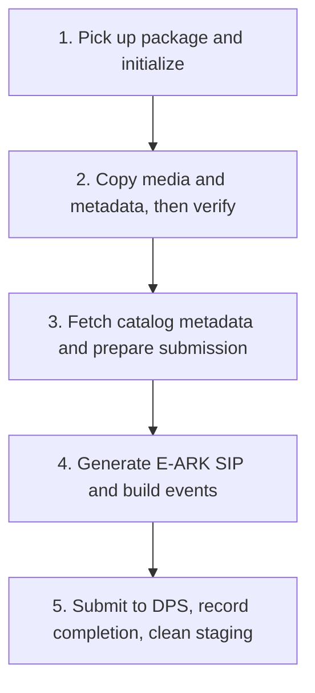

# Film → produksjon: simple transfer flow

Status: step-by-step implementation in progress. Package discovery,
initialization, and the two fetch scripts are available. The existing
produksjon DB pickup has selected a test package on production line 82, and
initialization has succeeded on nifi7. The user has reported a successful
2013 MOV fetch and checksum verification, completed Catalog/submission-body
preparation, and configured E-ARK. Their live configuration is not fully
exported here. The post-E-ARK event builder is locally tested against the
2023 metadata. Its [2013 live output](../examples/events/README.md) is recorded
from the successful nifi7 run after work cleanup; DPS completion remains pending.

Transfer the existing viewing/production media byte-for-byte from SAM-FS into
an E-ARK SIP and DPS. Reuse the existing NiFi groups and conventions, making
small adaptations for produksjon paths, source metadata, and catalog identity.
Keep the implementation local to this flow. Shared-code refactoring and new
reporting infrastructure are deferred until there is a concrete need.

The first target is the
[captured MOV package](../examples/sam-fs/digifilm_796646_20230321.notes.md).
Its audio is already inside the MOV. DPX extraction, batching, RAWcooked,
compression statistics, and scanner-event extraction are outside this flow.
Review other source layouts after the first package completes successfully.

The [bevaring implementation](../../film_bevaring/README.md) and supplied NiFi
screenshots are references for reuse. Live DB queries, processor properties,
controller services, and DPS configuration still need to be captured as we
reach each step.

## Main path



These are five walkthrough stages; existing NiFi process groups can keep
their current boundaries. Checksum verification after copying and package
checksum generation during E-ARK remain separate responsibilities within
this path.

## Step-by-step walkthrough

Work through one stage at a time using the existing processors. Record the
necessary changes and confirm each stage's output before moving to the next.
The first goal is one package reaching confirmed DPS completion.

### 1. Pick up the package and initialize

Start with **Find new package in DB** and its input preparation. The existing
[package-discovery helper](../00_Package%20discovery/README.md) emits one
FlowFile per `produksjon/<year-month>/<package>` directory, carrying
`package.name` and `package.path`. Database insertion and subsequent pickup
are separate steps.

The current produksjon pickup uses:

```sql
SELECT `ID`, `DESCRIPTION`
FROM `DIGITIZED_ITEM`
WHERE `STATUS` = 'Transfer.ready'
  AND `Pline_id` = 82
LIMIT 1;
```

The ID becomes `prod_db_id` and the description becomes `prod_db_description`.
The path lookup then uses:

```sql
SELECT `PARAMETER_VALUE`
FROM `DI_PARAMETER`
WHERE `DI_ID` = ${prod_db_id}
  AND `PARAMETER_NAME` LIKE 'package%path'
LIMIT 1;
```

These are the existing produksjon PG's queries. Selection is read-only; the
PG's STARTED update comes later. Trigger overlap and empty-result handling
still need review before unattended pickup. The input-row preparation queries
have not been captured.

For testing, a manual GenerateFlowFile bypasses the STARTED update and passes
`package.name=digifilm_1300107_20130729`, the corresponding source path,
`prod_db_id=49062190`, `prod_db_description`, and `package.uuid` directly to
Initialize. It can have an empty body. Keep DB status writers and DPS submission
stopped while testing initialization.

Run the two [produksjon initialization scripts](../01_Initialize/README.md)
in order. The default local roots are:

| Attribute | Value |
|---|---|
| `work.base.dir` | `/fc1/film_produksjon/work` |
| `payloads.base.dir` | `/fc1/film_produksjon/payloads` |
| `transfer.base.dir` | `/fc1/film_produksjon/transfer` |
| `source.dir` | Validated `package.path` under `/global/film/00/film/produksjon/` |
| `rep.dir` | `<work.dir>/representations/primary_20130729` for the manual test |
| `rep.data.dir` | `<rep.dir>/data` |

The initializer appends the validated package name under each local root and
uses its terminal calendar date for a stable representation name. This date
is a naming token, not evidence of the historical derivation date. Incoming
base-directory attributes can override the defaults. The MOV source and
destination paths use `<package.name>.mov`.

The package's source METS is assigned to
`<work.dir>/metadata/descriptive/deprecated_mets/` through
`metadata.descriptive.depr_mets.dir`, matching bevaring's placement. The complete
document is retained unchanged, including its descriptive, technical, and
provenance information; the historical folder name does not make that content
obsolete.
The four known legacy MAVIS XML snapshots share that directory, unchanged
and with their original names. They are grouped as legacy metadata, not
converted into METS. Current catalog exports remain directly under
`metadata/descriptive/`. No separate `legacy_mavis/` directory is created.
After updating the scripts, use a fresh manual trigger and run Initialize
again to replace the old path attributes. Existing test directories are not
automatically migrated or removed. Reconcile any previous `legacy_mavis/`
copies into `deprecated_mets/` without overwriting different content before
SIP generation; see [Initialize](../01_Initialize/README.md).

Directory initialization creates the local staging/metadata directories and
missing payload files, retaining existing event and submission content on
reruns. It prepares `transfer.dir` as an attribute for E-ARK to create later.
Neither script reads the FlowFile body or writes to the database.

**Check before continuing:** the manual test retains its package/DB identity,
has the expected source and local paths, and reports `setup.status=OK` after
directory initialization. Source file existence and checksums are checked
in the next stage.

### 2. Copy media and source metadata, then verify

Run the two [Fetch scripts](../02_Fetch%20files/README.md) in order:

1. Fetch and organize the source XML and logs. Bind the
   METS file entry through `ADMID` to its PREMIS object and extract expected
   MOV identity, size, and MD5. Check agreement with available METS attributes,
   JHOVE, and MAVIS carrier update evidence. Ignore regular `.done` files;
   they do not trigger unclassified review or enter the staged package.
   Other unknown entries require review before media copying.
2. Copy `lossless/<package.name>.mov` unchanged into a temporary local file,
   read the staged bytes to verify size and MD5, then publish the verified MOV
   under `rep.data.dir`. A previously staged MOV is verified again before
   reuse. A mismatching existing file is retained and the run fails.

The first processor uses the [metadata mapping](METADATA_MAPPING.md) and can
be tested without copying the large MOV. The current 2013 package's XML has
not yet been captured, so start with that metadata-only live run. Local tests
use the captured 2023 XML and small synthetic media; no real MOV transfer has
been performed by this implementation yet.

Missing, ambiguous, conflicting, or mismatching required evidence routes to
failure. Unknown metadata is retained in unclassified review; unexpected
media is flagged without being copied. Neither script changes source files
or writes to the DB. This step performs source fixity verification, so a
separate DPX-style Checksum PG is unnecessary for this path.

**Check before continuing:** the media and source metadata are staged in their
assigned locations, no unclassified entries remain, and `fetch.status=OK`
and `checksum.status=OK` confirm the staged MOV matches its expected size
and MD5. Queue the result for Catalog while that stage is adapted.

### 3. Fetch catalog metadata and prepare the submission

Reuse the catalog retrieval and
[submission-body components](../../film_bevaring/07_Submission%20body/),
adapting the lookup to the viewing-file URN. Confirm that the returned current
catalog records belong to this media file and contain the required identity
and title fields. The legacy MAVIS snapshot remains source metadata alongside
the current catalog exports.

Use the package name as the candidate DPS `objectId`, subject to the selected
contract's rules. The related preservation/core-file URNs document provenance;
the viewing-file URN supplies this package's catalog identity.

**Check before continuing:** current catalog XML is staged and a populated
submission body identifies the correct viewing/production object.

### 4. Generate the E-ARK SIP and build events

Use `EarkSIPGenerator` with produksjon paths after all media and catalog XML
are staged. Leave **Checksum File** unset, as agreed: the generator calculates
its package checksums. Fetch's earlier MOV fixity verification remains a
separate check against historical source evidence; it does not create a
`checksums.md5` file. No extra checksum-generator processor is required here.
E-ARK produces the new structure and METS around the existing media and metadata.

On generator success, immediately capture `eark.end` and the actual software
versions. Run [work-only cleanup](../05_Cleanup%20work/README.md) to remove the
package's `work.dir` and any root scratch files, then the
[three-event builder](../04_Events/README.md). The builder reads retained legacy
METS and the MOV inside `transfer.dir`, not the deleted work paths, and writes
external `events.ndjson`. It does not modify the completed SIP or put events
into the package after its checksums are made. Keep `transfer.dir` and
`payloads.dir` for event creation, DPS delivery, and retries. Earlier
work-dependent stages such as fetch still need restaging after cleanup;
event-build retries do not.

**Check before continuing:** the generated SIP includes the unchanged MOV and
all intended metadata, with checksums and file references matching its layout.

### 5. Submit to DPS, record completion, and clean staging

Reuse the existing DPS-2 submission, upload, response handling, and retry
groups with produksjon configuration. Retain the submission ID so retries can
resume the same submission. Preserve the distinction between submission
acceptance, completed uploads, and confirmed DPS preservation completion.
The final DB status and cleanup trigger follow the confirmed completion
condition established by the live response-handling configuration.

Adapt [finalization](../../film_bevaring/09_Finalize%20stats/) to the small set
of transfer fields below, and configure
[cleanup](../../film_bevaring/10_Package%20cleanup/) for this flow's local
roots. This final all-directory cleanup is separate from early work-only
cleanup and must wait for confirmed DPS completion. SAM-FS source deletion
is a separate operation.

**Check before completing the first run:** DPS confirms completion, the DB
records the submission and outcome, and eligible local staging is cleaned.

## Events and basic operations

Use the [produksjon event builder](../04_Events/README.md) after E-ARK success
for historical FFmpeg `creation`, SAM-FS `transfer` including MOV verification,
and `information package creation`. Each keeps its own evidence-based timestamp.
Do not also append these records using bevaring's appender. Preserve the original
`derivation` evidence in the unchanged legacy METS. This flow performs no new
media conversion. Finish event writes before the DPS upload stage, retaining
the existing flat NDJSON upload shape specified by the published OpenAPI.

Keep the existing DB model (`DIGITIZED_ITEM`, `DI_EVENT`, `DI_PARAMETER`) and
NiFi queue/error monitoring. Record package identity, source path, state,
fixity result, DPS submission ID/status, overall start/end times, and final
package bytes. Detailed stage timings, compression metrics, and a new Grafana
dashboard are outside the first implementation.

Use the existing error conventions (`prod_db_id`, package identity,
`error.stage`, and `error.message`) and preserve staged files needed for retry.
Use queue backpressure and concurrency appropriate to local capacity; the
sample MOV alone is about 206 GiB. A bounded review queue is sufficient to
start; add more elaborate buffering only if operation shows a need.
